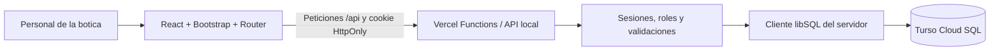
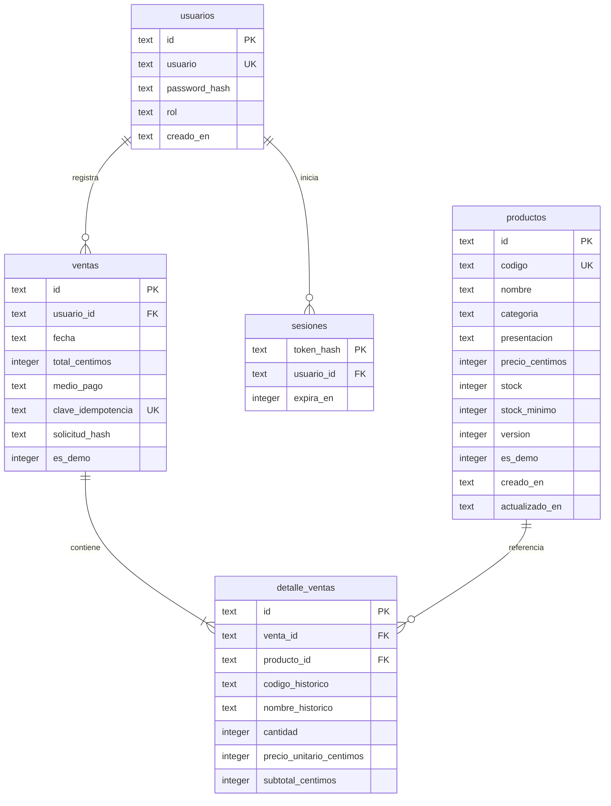
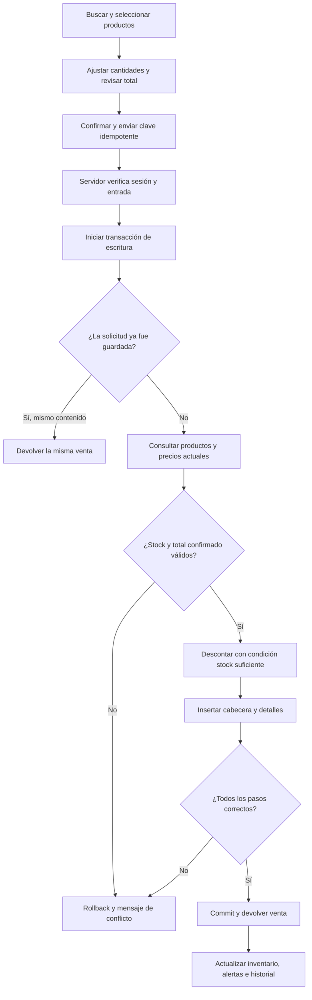

# NOVA SALUD · Trabajo final SENATI

Curso Fullstack Developer Software · PIAD-527.

## 1. Descripción del problema

La botica Nova Salud controla existencias y ventas manualmente. Su crecimiento provoca errores de inventario, desabastecimiento y tiempos prolongados de atención. La información dispersa impide conocer con rapidez los productos disponibles y decidir qué reponer.

## 2. Objetivo general

Implementar un software web que permita gestionar de forma centralizada y automatizada el inventario, las ventas y la atención al cliente de la botica Nova Salud.

## 3. Propuesta de solución

La aplicación organiza el trabajo en resumen general, inventario, alertas de reposición, nueva venta e historial. Los productos y ventas se almacenan en Turso a través de una API protegida por sesiones.

Se implementaron la interfaz, el esquema relacional, las operaciones persistentes, las alertas sobre datos reales, la venta transaccional y un acceso con roles. El diseño existente se conserva. La aplicación está publicada en https://novasalud.vercel.app y se verificó su API real; la inspección visual completa sigue pendiente.

## 4. Tecnologías elegidas

| Tecnología                     | Justificación                                                                |
| ------------------------------ | ---------------------------------------------------------------------------- |
| React, JavaScript y JSX        | Componentes y actualizaciones de pantalla al cambiar datos.                  |
| Vite                           | Desarrollo y compilación; middleware local para ejecutar la misma API.       |
| Bootstrap 5 y CSS              | Grilla, formularios, tablas, tarjetas y componentes con el diseño existente. |
| React Router y Bootstrap Icons | Navegación e iconografía coherentes.                                         |
| Node y Vercel Functions        | API REST, autorización y validaciones del servidor.                          |
| Turso y @libsql/client         | SQL persistente y transacciones de escritura; SDK solo del servidor.         |
| GitHub                         | Repositorio y documentación del proyecto.                                    |
| Vercel                         | Publicación del frontend y la API en https://novasalud.vercel.app.           |
| node:test y jsdom              | Pruebas de reglas, SQL, HTTP e interacción con React.                        |

No se contrataron servicios ni se ingresaron tarjetas. Las condiciones de los planes gratuitos se deben revisar antes de publicar.

## 5. Arquitectura del sistema

Localmente, un plugin de Vite monta los manejadores Node bajo /api. En Vercel se utilizan los archivos de api/. Ambos reutilizan server/application.js, los servicios SQL y las validaciones.

El navegador recibe productos, ventas y el estado público de conexión. Nunca recibe el token ni la URL privada de Turso. La información importante no se almacena en localStorage.

## 6. Base de datos implementada

También existen schema_migrations e intentos_login. El esquema está en server/schema.js y se aplica con npm run db:migrate. La migración es repetible y no inserta datos de demostración.

La versión 2 añade marcas persistentes `es_demo` sin eliminar medicamentos, usuarios ni ventas existentes. La carga académica se ejecuta explícitamente con `npm run db:seed-demo`, reserva códigos DEMO y números de boleta estables, conserva el stock de los registros del usuario y no duplica ni repone los ejemplos al repetirse. Las seis boletas se generan con el mismo servicio transaccional y descuentan el stock de sus productos de demostración.

Las restricciones incluyen claves foráneas, códigos únicos sin distinguir mayúsculas, roles válidos, precios positivos, stock no negativo, cantidades enteras positivas y unicidad de producto por venta. Los detalles preservan código, nombre y precio históricos. Las transacciones verifican que las claves foráneas estén activadas.

## 7. Proceso de venta

El backend no acepta precios ni subtotales como autoridad. Los calcula desde SQL y compara el total con el importe confirmado. Si los precios cambiaron, revierte la operación para que el usuario revise el importe.

El descuento utiliza UPDATE con condición stock >= cantidad, dentro de la misma transacción que las inserciones. Un fallo revierte cabecera, detalles, stock y versiones. La clave idempotente evita duplicados si se repite una solicitud después de un problema de red.

Se comprobó en Turso que dos solicitudes simultáneas desde clientes independientes no pueden vender dos veces la última unidad.

## 8. Control de inventario

El formulario registra código, nombre, categoría, presentación, precio, stock y mínimo. Cliente y servidor validan los campos, y SQL aplica las restricciones finales. Todas las entradas variables se transmiten mediante parámetros SQL.

La edición envía la versión que el usuario consultó. Si otra operación modificó el producto, el servidor responde con conflicto para impedir que una edición antigua restaure existencias ya vendidas. Es necesario cerrar y volver a abrir el formulario para trabajar sobre la versión reciente.

La API confirma el guardado antes de cerrar el formulario. Los medicamentos se recuperan desde Turso después de recargar o reiniciar el servidor.

## 9. Alertas de reposición y seguridad

| Regla                                  | Estado                |
| -------------------------------------- | --------------------- |
| Stock cero                             | Agotado, rojo.        |
| Stock positivo menor o igual al mínimo | Stock bajo, amarillo. |
| Stock mayor al mínimo                  | Disponible, verde.    |

Las alertas se calculan a partir del inventario real. Guardar productos, reponer o vender actualiza el estado. Las vistas se refrescan al recuperar el foco y periódicamente mientras existe una sesión.

El primer administrador se crea una sola vez y únicamente desde el servidor local. El administrador registra y edita productos; los roles admin y vendedor pueden consultar y vender. Las contraseñas se guardan con scrypt, sal aleatoria y comparación segura.

Las sesiones usan tokens aleatorios de 256 bits, guardan únicamente su hash y expiran en 8 horas. La cookie es HttpOnly y SameSite=Strict; en producción incorpora Secure. Hay validación de origen, cuerpo JSON y límite de tamaño, además de bloqueo temporal tras intentos de acceso fallidos.

Las variables privadas se cargan desde .env.local localmente o desde Vercel en producción. El frontend solo utiliza el cliente HTTP público. La etiqueta Turso conectado depende de una consulta SELECT real completada correctamente.

## 10. Instalación, uso y pruebas

Consultar [README](../README.md) para los comandos exactos, primer acceso, prueba de persistencia y configuración de Vercel. Consultar [PRUEBAS](PRUEBAS.md) para las 34 pruebas locales y la verificación remota. Las boletas internas son imprimibles y las de ejemplo muestran de forma destacada que no tienen validez fiscal. El modo nocturno utiliza el tema de Bootstrap y conserva la preferencia visual en el navegador, mientras los datos de inventario y ventas permanecen en Turso.

La base remota no se sustituye por SQLite dentro de Vercel Functions. Se comprobó persistencia con un cliente independiente, rollback, rechazo por stock insuficiente, concurrencia e idempotencia. Los registros técnicos de la prueba se retiraron al terminar.

## Preguntas guía PIAD-527

La solicitud no contiene la redacción literal de las cinco preguntas. Se requiere el PDF o su transcripción para responderlas fielmente. Se mantiene NOVA SALUD como nombre del proyecto aunque las preguntas originales mencionen FarmaPlus.

## Referencias técnicas

- [Cliente oficial libSQL JavaScript](https://github.com/tursodatabase/libsql-client-ts).
- [Referencia oficial de Turso](https://docs.turso.tech/sdk/ts/reference).
- [Runtime Node de Vercel Functions](https://vercel.com/docs/functions/runtimes/node-js).
- [Middleware configureServer de Vite](https://vite.dev/guide/api-plugin#configureserver).
