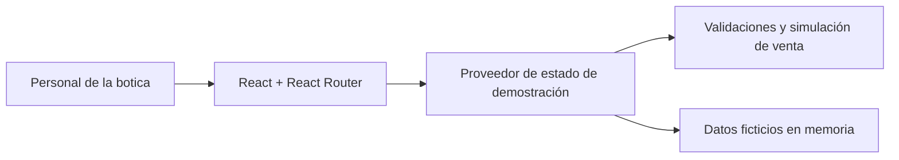
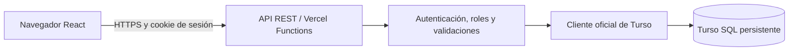
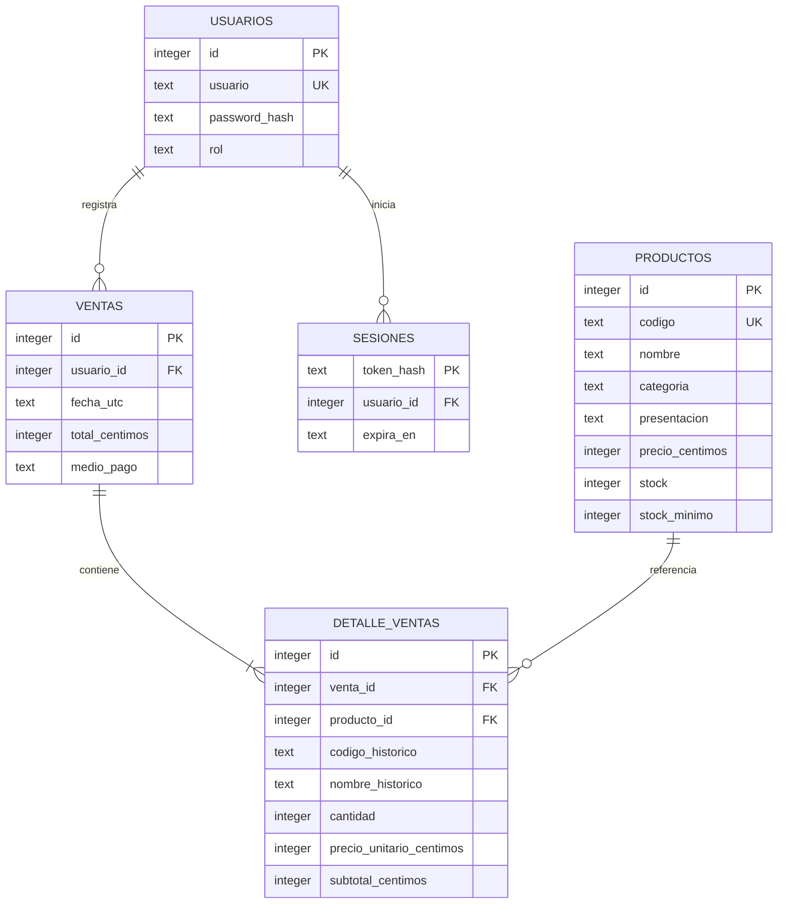
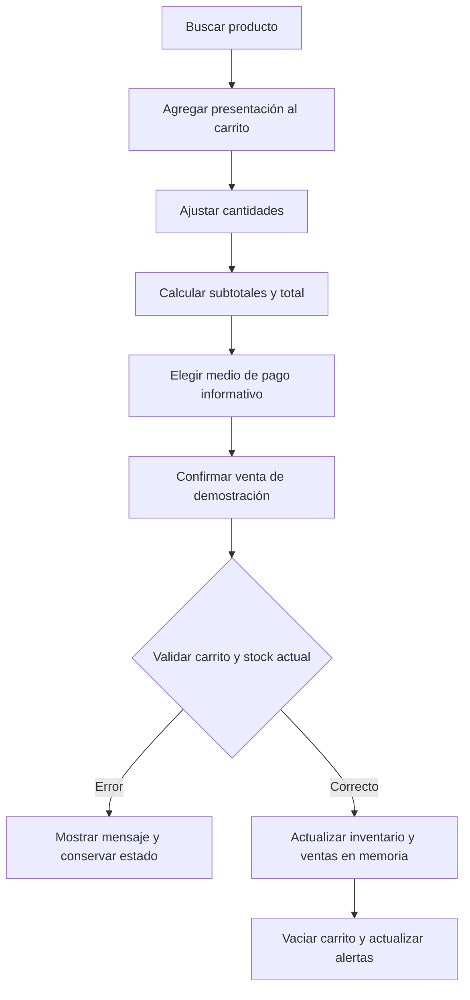

# NOVA SALUD · Documentación del trabajo final

Curso Fullstack Developer Software · SENATI · PIAD-527.

## 1. Descripción del problema

La botica Nova Salud registra inventario y ventas manualmente. El crecimiento de la atención provoca errores en las existencias, desabastecimiento de medicamentos y tiempos prolongados de registro. La información dispersa dificulta conocer los productos disponibles y decidir qué reponer.

## 2. Objetivo general

Implementar un software web que permita gestionar de forma centralizada y automatizada el inventario, las ventas y la atención al cliente de la botica Nova Salud.

## 3. Propuesta de solución

La aplicación organiza el trabajo en cinco pantallas: resumen general, inventario, alertas, nueva venta e historial. La búsqueda por nombre o código agiliza la atención; los formularios evitan datos incoherentes; las alertas señalan faltantes. Una venta debe registrar sus detalles y descontar existencias como una única operación.

**Alcance implementado:** fases 1 y 2, interfaz y simulación en memoria. **Alcance pendiente:** API, persistencia en Turso, autenticación, transacciones reales y despliegue. Los registros actuales son ficticios y no sirven para operar la botica en producción.

## 4. Tecnologías y justificación

| Tecnología                                     | Uso                                                                                   |
| ---------------------------------------------- | ------------------------------------------------------------------------------------- |
| React, JavaScript y JSX                        | Componentes reutilizables y actualización de pantallas ante cambios.                  |
| Vite                                           | Servidor de desarrollo y compilación del frontend.                                    |
| Bootstrap 5 y CSS                              | Grilla adaptable, tarjetas, tablas, formularios, estilos de modales y notificaciones. |
| Bootstrap Icons                                | Iconografía coherente, servida localmente sin depender de CDN.                        |
| React Router                                   | Navegación entre módulos y enlaces a detalles de ventas.                              |
| Node y su ejecutor de pruebas                  | Herramientas locales y pruebas de reglas de negocio.                                  |
| jsdom                                          | Verificación automatizada del árbol DOM sin sustituir la revisión visual real.        |
| Node + Vercel Functions (pendiente)            | API REST con credenciales privadas y validación del servidor.                         |
| Turso + cliente oficial JavaScript (pendiente) | Almacenamiento SQL persistente y transacciones.                                       |
| GitHub y Vercel (pendientes)                   | Repositorio y publicación.                                                            |

No se contrataron servicios, ingresaron tarjetas ni crearon cuentas. El frontend no necesita servicios externos para funcionar en modo demostración. Las condiciones vigentes de los planes gratuitos deben comprobarse antes de publicar.

## 5. Arquitectura

### Estado actual

La navegación comparte inventario, carrito y ventas mediante un proveedor de React. Las operaciones se procesan sobre el último estado con un reducer. Una venta se prepara sin modificar los objetos originales; si falla, no se actualiza ninguna parte del estado. Esto mejora la coherencia de la demostración, pero **no ofrece garantías de una base de datos ni resuelve concurrencia entre usuarios**.

### Arquitectura prevista para las siguientes fases

Las credenciales de Turso y la clave de sesión permanecerán en variables privadas del servidor. El navegador no recibirá tokens de base de datos. El precio, los subtotales, los permisos y el stock se validarán nuevamente en la API.

## 6. Modelo relacional previsto (todavía no implementado)

Se requieren restricciones de unicidad para códigos y usuarios; claves foráneas; precios positivos; cantidades enteras positivas en detalles; stock y mínimos no negativos; unicidad del par venta/producto; y restricciones para roles. Los precios se almacenarán en céntimos enteros. Los detalles conservarán código, nombre y precio históricos aunque se edite el producto. No se deben borrar productos referenciados por ventas; una futura baja deberá ser lógica.

## 7. Proceso de venta

### Interacción implementada

### Garantía transaccional pendiente

En el servidor deberá abrirse una transacción de escritura, cargar precios desde SQL y descontar cada producto con una consulta parametrizada condicionada a `stock >= cantidad`. Si cualquier descuento no afecta exactamente una fila, debe hacerse rollback de la operación completa. La cabecera y los detalles se insertarán en la misma transacción; solo después se hará commit. Se deben probar dos solicitudes simultáneas sobre las últimas unidades. Ninguna validación exclusivamente en React garantiza esta propiedad.

## 8. Control de inventario

El formulario registra código único, nombre, categoría, presentación, precio, stock y mínimo. Rechaza valores negativos, cantidades fraccionarias y códigos repetidos. La búsqueda ignora mayúsculas y tildes. Los filtros permiten consultar categoría y estado. El precio y la cantidad corresponden a la presentación indicada, no a tabletas individuales.

Actualmente los cambios duran mientras la aplicación siga abierta. La fase de Turso debe sustituir el almacenamiento en memoria por lecturas y escrituras persistentes autenticadas. Se debe comprobar la persistencia al recargar, cerrar sesión y volver a desplegar.

## 9. Alertas de reposición

| Regla                                          | Estado visual         |
| ---------------------------------------------- | --------------------- |
| Stock igual a cero                             | Agotado, rojo.        |
| Stock mayor que cero y menor o igual al mínimo | Stock bajo, amarillo. |
| Stock mayor que el mínimo                      | Disponible, verde.    |

La regla se deriva del inventario, por lo que editar existencias, registrar una venta o reponer un producto actualiza las alertas y el resumen. No existen alertas persistidas separadas que puedan quedar desactualizadas. La reposición en esta etapa usa el formulario de edición; los movimientos auditados se diseñarán en las fases del backend.

## 10. Instalación y funcionamiento

Consultar [README](../README.md) para comandos, estructura, ejecución y próximas fases. Consultar [PRUEBAS](PRUEBAS.md) para verificaciones y limitaciones.

## Preguntas guía PIAD-527

La solicitud no incluye el contenido literal de las cinco preguntas guía. Se requiere el PDF original o su transcripción para responderlas respetando su contenido. No se han inventado ni sustituido por preguntas genéricas. Se conservará NOVA SALUD como nombre del proyecto aunque las preguntas mencionen FarmaPlus.
